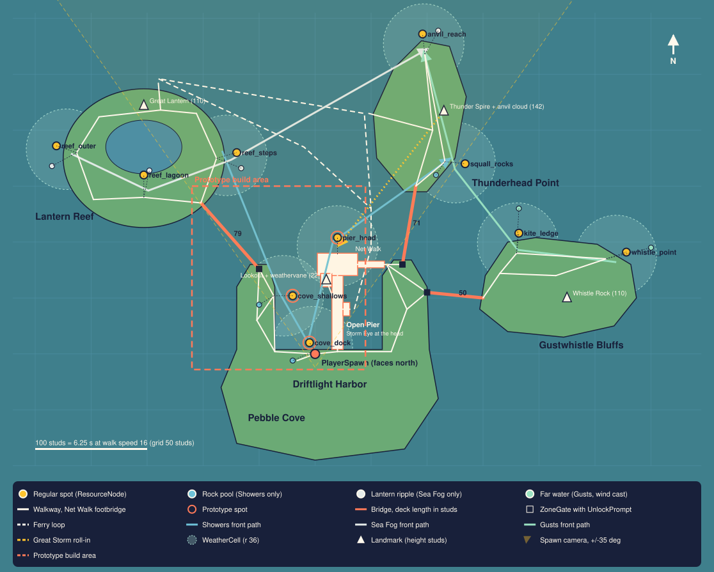

# Reel the Storm: world plan

Task T-0011 · Worldbuilder · 2026-10-25 · Stage: design · Outcome served: **stay**. The plan is a compact archipelago where the next goal is always in sight, every front is a short walk away, and the whole map is cheap enough for a low-end phone.

**Inputs.** `loop-sketch.md` sections 3 (cozy rules), 4.1 (islands, home weathers, fronts), 5 (first session, spawn facing the water, bridge visible from spawn) and 7 (template reuse map); `decisions.md` D1-D6; `art-direction.md` (T-0010, written in parallel and read on 2026-10-25: palette, materials, lighting presets, VFX budget per weather). Vault: `06-world-and-look/world-and-level-design.md`, `build-budgets.md`, `lobby-and-hub-design.md`, `lighting-and-atmosphere.md`, `art-direction.md`; `08-mobile-and-cross-platform/device-performance.md`; `19-vfx/vfx-performance-budgets.md`, `19-vfx/environment-and-ambient-vfx.md`; `01-first-five-minutes/first-session-blueprint.md`. Template code: `games/stormcatch/project/src/` and `template/README.md`.

**Labels.** *Template fact*: read from the project code, with file and line. *Vault budget*: a number or rule from the vault, with its note. *Measured*: computed by the layout model below from this plan's coordinates. *Starting value*: my first pass, to be measured in the prototype and tuned.

**The model.** Every coordinate in this plan lives in one script, [`models/world_layout.py`](models/world_layout.py) (stdlib Python, no dependencies). It computes the shortest walking path between every pair of spots over the walkway graph and checks the cozy rules, cast ranges, weather cells, ferry clearance and first-frame sightlines. It also draws the maps. Re-run it with:

```text
python3 games/stormcatch/docs/models/world_layout.py --svg games/stormcatch/docs/world-map.svg
```

The run on 2026-10-25 ends with "All checks pass" (exit code 0). Its full output is stored in [`models/world_layout_output.txt`](models/world_layout_output.txt). The tables below are copied from it.

This is a plan, not a build: no Studio work, no lease, no assets, and nothing paid.

---

## 1. The map in one line

**A hub and three spokes around a small lagoon.** Pebble Cove is the hub at the south: its harbour, Driftlight Harbor, faces north across a sheltered cove, and the Open Pier runs out to the cove mouth. Three short bridges lead from the hub: west to Lantern Reef (an atoll ringed by boardwalks), east to Gustwhistle Bluffs (cliffs and ledges), and north-east to Thunderhead Point (a headland under a permanent anvil cloud). A small ferry loops across the lagoon between the harbour and the two northern islands.

**Why this structure.** The vault's map-structure table recommends hub and spokes for simulators and social games ("Central hub with zones branching out"), and the loop needs one in particular. The Great Storm happens at the Open Pier every 15 minutes (loop sketch 4.1), so every island must be close to the pier. Players are kept near each other ("Players near players", world-and-level-design principle 4), and the busiest place, the pier, can see all three bridge gates. Unlocks still follow the template's linear chain: `Systems/Zones.luau:46-47` refuses a zone until the previous one is unlocked, so the geometry is hub and spokes while the progression stays Lantern Reef, then Gustwhistle Bluffs, then Thunderhead Point.

## 2. Top-down map

The SVG map, drawn by the model to scale: [world-map.svg](world-map.svg) (grid 50 studs; 100 studs is 6.25 s of walking).



The same layout as ASCII, rasterised by the model (one character is 9 studs east-west and 18 studs north-south; north is up):

```text
~~~~~~~~~~~~~~~~~~~~~~~~~~~~~~~~~~~~~~~~~~~~~~~~~~~~~~~~~~~~~~~~
~~~~~~~~~~~~~~~~~~~~~~~~~~~~~~~~~~~~~~0~o~~~~~~~~~~~~~~~~~~~~~~~
~~~~~~~~~~~~~~~~~~~~~~~~~~~~~~~~~~~~~.....~~~~~~~~~~~~~~~~~~~~~~
~~~~~~~~~~~~:::::::~~~~~~~~~~~~~~~~~.......~~~~~~~~~~~~~~~~~~~~~
~~~~~~~....^...::::::::::::::::~~~~........~~~~~~~~~~~~~~~~~~~~~
~~~~~.............~:::::~~~~~~::::.......^.~~~~~~~~~~~~~~~~~~~~~
~~6~....~~~~~~~....~~~~:::::~~~~~:.........~~~~~~~~~~~~~~~~~~~~~
~~o.....~~~~~~~....~4~~~~~~:::~~~:........~9~~~~~~~~~~~~~~~~~~~~
~~~~.......5.......~~~~~~~~~~~::~:~~..=.o~~~~~~~~~~~~~~~~~~~~~~~
~~~~~...........==~~~~~~~~~~~~~:::~~~==~~~~~~~~~o~~~~~~~~~~~~~~~
~~~~~~~~.......~~==~~~~~~~~~~~~~~:~~~=~~~~~~~~~~~~~~~~~~~~~~~~~~
~~~~~~~~~~~~~~~~~~~==~~~~~~~~~3~~:~~~=~~~~~~~~~~7...~~~~~~~~~o~~
~~~~~~~~~~~~~~~~~~~~~=#~~~~~||------#=~~~~~~~~.............8~~~~
~~~~~~~~~~~~~~~~~~~~~...~~~~|^|||:~....~~~~~~...............~~~~
~~~~~~~~~~~~~~~~~~~~..o.~~2~~||~:~~....#=====........^......~~~~
~~~~~~~~~~~~~~~~~~~~....~~~~~||~~~~.....~~~~~~............~~~~~~
~~~~~~~~~~~~~~~~~~~~....~~~1~||~~~~.....~~~~~~~~~~~~~~~~~~~~~~~~
~~~~~~~~~~~~~~~~~~~~......o.S...........~~~~~~~~~~~~~~~~~~~~~~~~
~~~~~~~~~~~~~~~~~~~.....................~~~~~~~~~~~~~~~~~~~~~~~~
~~~~~~~~~~~~~~~~~~~.....................~~~~~~~~~~~~~~~~~~~~~~~~
~~~~~~~~~~~~~~~~~~~~...................~~~~~~~~~~~~~~~~~~~~~~~~~
~~~~~~~~~~~~~~~~~~~~..................~~~~~~~~~~~~~~~~~~~~~~~~~~
~~~~~~~~~~~~~~~~~~~~~~~~~~~~~~~~~~~~~~~~~~~~~~~~~~~~~~~~~~~~~~~~
```

Key: `S` spawn (faces north); regular spots `1` cove_dock, `2` cove_shallows, `3` pier_head, `4` reef_steps, `5` reef_lagoon, `6` reef_outer, `7` kite_ledge, `8` whistle_point, `9` squall_rocks, `0` anvil_reach; `o` weather-only spot; `#` ZoneGate; `=` bridge; `-` Net Walk footbridge; `|` Open Pier; `^` landmark; `:` ferry loop; `.` land; `~` water.

**Key distances (measured):** bridge decks 79, 50 and 71 studs; the Open Pier is 90 studs from the quay to the head's front rail; the Net Walk footbridge is 44 studs; the walkable and fishable extent is 535 x 295 studs; every spot is within 280 studs (straight line) of the pier head.

**Coordinates.** Roblox world studs: +X east, +Z south (north is -Z, the default `LookVector`), +Y up. Sea level, the terrain water surface, is Y = 0. Decks are at Y 4-5, the Bluffs ledges at Y 12 and the ridge at Y 18. The model lists every node; the main ones are in section 6.

## 3. Template facts this plan builds on

| Fact | Value | Source (template fact) |
|---|---|---|
| Base walk speed | **16 studs/s** | `project/src/shared/Util/Stats.luau:103` `walkSpeed = 16 + upgradeLevel(data, "speed") * upgradeEffect("speed")`, applied in `Systems/Characters.luau:28`. The vault agrees: "Default walk speed is 16 studs per second" (`world-and-level-design.md`, Scale and the Roblox character). |
| Walk speed upgrade | +1 per level, max level 16, so **32 at most** | `Config/Upgrades.luau:34-41` (`id = "speed"`, `effect = 1`, `maxLevel = 16`). Boots replace it (loop sketch section 7), and the Economist sets their curve. |
| Action range | 28 studs from the root part to the node; the server allows +8 | `Config/Economy.luau:10` `hitRange = 28`; `Systems/Nodes.luau:26` `LATENCY_RANGE_MARGIN = 8`, check at line 48 |
| Tap to act, or walk to a far node | Raycast from the tap, then `humanoid:MoveTo(node.Position)` when farther than 28 | `Controllers/Interact.luau:164-167` (raycast), `:115-120` (MoveTo) |
| World contract | Tags `ResourceNode` (`NodeId`, `ZoneId`), `ZoneGate` (`ZoneId`), `EggStand` (`EggId`, `ZoneId`), `ZoneBounds` (`ZoneId`), and a `SpawnLocation` named `PlayerSpawn`, all under `Workspace.World` | `template/README.md` "Making it your game" step 3; `Systems/World.luau:4-6`, `:22-27`, `:224-255` |
| Unlock prompt | ProximityPrompt named `UnlockPrompt` anywhere under the gate part (the template puts it on an Attachment); `MaxActivationDistance` 14 | `Controllers/Gates.luau:116-122` (`FindFirstAncestorWhichIsA("BasePart")`); `World.luau:206-216` |
| One gate per zone | Server and client registries are keyed by `ZoneId`; a second gate for the same zone would never be reapplied | `World.luau:237`, `Gates.luau:71` |
| Gate is client-side only | Unlocking hides only the gate part, its prompts and its SurfaceGuis, locally | `Gates.luau:35-49` |
| Hatch prompt | `HatchPrompt` must be a **direct child** of the `EggStand` part (`prompt.Parent:GetAttribute("EggId")`); hatch range 18 | `Controllers/Hatch.luau:303-307`; `Config/Eggs.luau:100` |
| Zone bounds | Horizontal box test in the part's own space, no upper limit, lower limit 4 studs under the part; trespassers in a locked zone are returned to spawn every 2 s | `World.luau:275-288`; `Characters.luau:16`, `:32-44` |
| Ids | Identifiers match `^[%w_%-]+$`; zone ids are at most 32 characters, node ids at most 64 | `Util/Validate.luau:21-31`; `Zones.luau:34`; `Nodes.luau:31` |
| Zone config | `id, name, order, gateCost, valueMultiplier, nodeCount, color, nodeColor, eggId` | `Config/Zones.luau:5-15` |
| Spawn | `World.spawnCFrame()` keeps the spawn part's rotation, which is also used to return trespassers | `World.luau:290-296` |
| Odds boards | Only the placeholder builder makes the in-world odds board | `World.luau:76-120`, called at `:189` |
| Streaming | `Workspace.StreamingEnabled = true` | `games/stormcatch/project/default.project.json` |

## 4. The cozy rules in studs

The loop sketch's cozy rules (section 3), converted at the template's base walk speed of 16 studs/s:

| Cozy rule (loop sketch) | In studs | Plan target | Measured | Result |
|---|---|---|---|---|
| Adjacent spots at most about 15 s apart | 240 studs | 200 studs (12.5 s), leaving 2.5 s for turns and other players | Worst adjacent pair: pier_head to kite_ledge, 198 studs = **12.3 s** | pass (all 11 pairs) |
| A front is announced at least 60 s before it reaches a spot | Any spot reachable from any other within 960 studs | 720 studs (45 s), so a player arrives with at least 15 s of the warning left and then gets the full 90-120 s linger | Longest walk on the whole map: reef_outer to anvil_reach, 681 studs = **42.5 s** (9.3 s faster by ferry, section 8) | pass |
| The Great Storm draws everyone to the Open Pier (countdown from 5 min, loop sketch 5.4) | From any spot to the pier head | 720 studs (45 s) | Farthest: reef_outer, 440 studs = **27.5 s** | pass |
| The first spot is right in front of spawn (loop sketch 5.1: "a glowing ripple 8 studs ahead") | Under 10 studs | Ripple ring 10 studs across (art direction section 7) | Ripple centre 11 studs from the spawn centre, 8.6 studs past the dock edge, cast distance 11.1 | pass |
| Short trips between loop steps (vault: "target: a few seconds in the early game") | Spawn to the first upgrade-relevant places | Under 10 s | Spawn to Driftwood Nest 17 studs (1.1 s), to the bridge-1 gate 113 studs (7.1 s), to the pier head 107 studs (6.7 s) | pass |

### Distance table: adjacent spots (the 15-second rule)

"Adjacent" means every pair of regular spots on one island, plus the nearest pair across each bridge (the model picks it). Paths follow the walkways, including slopes.

| From | To | Path (studs) | Base walk, 16 studs/s (s) | At template Speed max, 32 (s) | Rule <= 15 s | Target <= 12.5 s |
|---|---|---|---|---|---|---|
| cove_dock | cove_shallows | 89 | 5.6 | 2.8 | pass | pass |
| cove_dock | pier_head | 110 | 6.9 | 3.4 | pass | pass |
| cove_shallows | pier_head | 193 | 12.1 | 6.0 | pass | pass |
| reef_steps | reef_lagoon | 94 | 5.9 | 2.9 | pass | pass |
| reef_steps | reef_outer | 169 | 10.6 | 5.3 | pass | pass |
| reef_lagoon | reef_outer | 90 | 5.6 | 2.8 | pass | pass |
| kite_ledge | whistle_point | 80 | 5.0 | 2.5 | pass | pass |
| squall_rocks | anvil_reach | 98 | 6.1 | 3.1 | pass | pass |
| cove_shallows | reef_steps (bridge 1) | 148 | 9.3 | 4.6 | pass | pass |
| pier_head | kite_ledge (bridge 2) | 198 | 12.3 | 6.2 | pass | pass |
| pier_head | squall_rocks (bridge 3) | 172 | 10.8 | 5.4 | pass | pass |

### All regular spots (seconds at 16 studs/s)

| | cove_dock | cove_shallows | pier_head | reef_steps | reef_lagoon | reef_outer | kite_ledge | whistle_point | squall_rocks | anvil_reach |
|---|---|---|---|---|---|---|---|---|---|---|
| cove_dock | - | 6 | 7 | 15 | 15 | 21 | 15 | 19 | 17 | 22 |
| cove_shallows | 6 | - | 12 | 9 | 10 | 15 | 20 | 25 | 22 | 27 |
| pier_head | 7 | 12 | - | 21 | 22 | 28 | 12 | 17 | 11 | 16 |
| reef_steps | 15 | 9 | 21 | - | 6 | 11 | 29 | 34 | 31 | 36 |
| reef_lagoon | 15 | 10 | 22 | 6 | - | 6 | 30 | 34 | 32 | 37 |
| reef_outer | 21 | 15 | 28 | 11 | 6 | - | 35 | 40 | 37 | 43 |
| kite_ledge | 15 | 20 | 12 | 29 | 30 | 35 | - | 5 | 16 | 22 |
| whistle_point | 19 | 25 | 17 | 34 | 34 | 40 | 5 | - | 21 | 27 |
| squall_rocks | 17 | 22 | 11 | 31 | 32 | 37 | 16 | 21 | - | 6 |
| anvil_reach | 22 | 27 | 16 | 36 | 37 | 43 | 22 | 27 | 6 | - |

### From spawn, and to the Open Pier for the Great Storm

| Spot | Spawn to the spot's stand (studs / s) | Stand to the Pier Head stand (studs / s) |
|---|---|---|
| cove_dock | 3 / 0.2 | 110 / 6.9 |
| cove_shallows | 86 / 5.4 | 193 / 12.1 |
| pier_head | 107 / 6.7 | 0 |
| reef_steps | 234 / 14.6 | 341 / 21.3 |
| reef_lagoon | 243 / 15.2 | 350 / 21.9 |
| reef_outer | 333 / 20.8 | 440 / 27.5 |
| kite_ledge | 233 / 14.5 | 198 / 12.3 |
| whistle_point | 308 / 19.2 | 273 / 17.0 |
| squall_rocks | 261 / 16.3 | 172 / 10.8 |
| anvil_reach | 348 / 21.7 | 259 / 16.2 |
| Goal: bridge-1 gate (Lantern Reef) | 113 / 7.1 | |
| Goal: bridge-2 gate (Gustwhistle Bluffs) | 132 / 8.3 | |
| Goal: bridge-3 gate (Thunderhead Point) | 156 / 9.8 | |
| Goal: Driftwood Nest | 17 / 1.1 | |

Two layout decisions came out of these checks. A first draft had a dead-end pier and failed the rule across bridges 2 and 3 (pier_head to kite_ledge took 19.8 s). The **Net Walk**, a 44-stud arched footbridge from the pier head to the Gull Point tip, makes the pier head the junction for bridges 2 and 3 and brought both pairs under 12.5 s. It also puts both gates in view of the storm crowd. Second, Boots matter for the chase, not for the cozy rules: the rules pass at base speed, and Boots halve the times at most (column "Speed max, 32").

## 5. Sightlines

### The first frame (vault: "The first frame should look like your thumbnail"; loop sketch 5.1)

PlayerSpawn faces north, toward the water. The default camera is assumed to be about 12 studs behind and above the avatar, at (0, 12.5, 12), with a vertical field of view of 70°. That gives about ±51° horizontally on a 16:9 phone and about ±43° on a 4:3 tablet. Must-see items have to sit inside a **core cone of ±35°**, which leaves room for the HUD at the screen edges.

| Target | Bearing (°, + = right) | Distance from camera (studs) | Elevation (°) | Must see | In view (measured) |
|---|---|---|---|---|---|
| Harbor Dock ripple (first spot) | -12.8 | 23 | -29.0 | yes | core |
| Cove Shallows cell ("a light shower over the far end of the cove") | -24.0 | 70 | -5.3 | yes | core |
| **Bridge 1 gate and price sign (the 10-15 minute goal)** | -29.6 | 101 | +0.8 | yes | core |
| Pier Head (the Great Storm's eye sits above it) | +12.3 | 94 | -5.2 | yes | core |
| Rumblefin weathervane on the lookout mast | +7.3 | 79 | +9.7 | no | core |
| **Thunderhead anvil cloud, base ("a dark storm cloud on the horizon")** | +26.7 | 256 | +8.3 | yes | core |
| Thunderhead anvil cloud, top | +26.7 | 256 | +28.2 | no | core (top may crop) |
| Great Lantern (Lantern Reef landmark), top | -33.2 | 280 | +20.1 | no | core |
| Bridge 3 gate (via the Net Walk) | +40.3 | 121 | +0.7 | no | frame |
| Whistle Rock (Gustwhistle landmark), top | +74.6 | 233 | +26.3 | no | off-frame (seen from the pier head) |

Rules that come out of this table:

- **The first ripple is offset 5 studs left of centre.** A ripple dead ahead at 21 studs from the camera sits about 29-31° below the view line, the same place as the avatar's torso on screen, so the avatar would hide it. Left also keeps it clear of the right-thumb Cast and jump buttons.
- **All three Pebble Cove weather cells are in the first frame** (cove_dock, cove_shallows, pier_head), so any Showers front over the hub can be seen from spawn. Whether a shower is actually there on a player's first frame depends on the schedule (open question 1).
- **The bridge-1 price sign is readable at 101 studs on a phone.** At that distance the screen height covers about 141 studs (2 × 101 × tan 35°). Letters 5 studs tall fill about 3.5% of it, about 14 pt on a phone held landscape. The template's `label()` caps text at 4 studs (`MaxTextSize` 80 at `PixelsPerStud` 20, `World.luau:56-69`), so the builder passes 120 for gate signs (6-stud letters). The sign faces south toward spawn and also says "Lantern Reef" on the back.
- **The storm cloud's base sits 8.3° above the horizon**, low enough to stay in frame with the default camera pitch. The anvil is a single cloud mesh at Y 50-150 over the Thunder Spire.
- Nothing tall stands between the camera and these targets: the cottages of Driftlight Harbor are south of the quay, behind spawn, and Pebble Point and Gull Point are low (Y 5).

### The next goal is visible from each island's busiest place (vault: "The gate to the next zone is visible from the current zone's busiest area")

| Busiest place | Next goal | Distance | Line of sight |
|---|---|---|---|
| Spawn and quay (new player) | Bridge-1 gate on the Pebble Point tip | 101 studs from the camera, -29.6° | Clear over the cove (above) |
| Pier head (every Great Storm) | Bridge-2 gate on the Gull Point east shore and bridge-3 gate on the Gull Point tip | 84 and 58 studs | Clear over the low Gull Point; the Net Walk leads straight to both |
| Lantern Reef landing | Bridge-2 gate is behind the hub, but Whistle Rock (110 studs tall) is visible over Pebble Cove | about 270 studs to Whistle Rock | Clear: Pebble Cove is low |
| Gustwhistle ridge (Y 18) | Thunder Spire and anvil cloud, and the bridge-3 gate | about 165 studs to the spire | Clear from the ridge |

Landmarks follow the vault's rule of "100+ studs tall to read as landmarks from across a zone": the Great Lantern is 110, Whistle Rock 110, and the Thunder Spire rises 60 studs into the anvil cloud (top at Y 150). The hub's landmark is the Open Pier itself, with its lookout mast and string lights. During a storm, the eye halo over the pier (art direction section 6) marks it from every island.

## 6. Island by island

Every island has a landmark, a palette, a home weather and something new (vault checklist: "Each zone has a landmark, a palette, and at least one new mechanic or resource"). Colours and per-weather lighting follow `art-direction.md` sections 2 and 6. The base mood below is the Clear preset for that island, a proposal the Artist confirms.

### 6.1 Pebble Cove (with Driftlight Harbor and the Open Pier): zone `pebble_cove`, order 1, home weather Showers

- **Footprint:** about 190 x 180 studs. The village is south of the quay. The cove is 96 x 76 studs of water, enclosed by **Pebble Point** (west arm) and **Gull Point** (east arm). Decks are at Y 4 and the arms at Y 5.
- **Spawn:** `PlayerSpawn` at (0, 4, 0), 8 x 1 x 8, orientation (0, 0, 0) so it faces north. `Duration` 0 and `Neutral` true, as in the template. It is built as planks of the dock, not as a visible pad.
- **The Open Pier:** a 10-stud-wide deck from the quay at X 20 north to a **36 x 20 head** (X 2..38, Z -70..-90). Any two players on the head are at most 41 studs apart, so a Pull circle of about 40 studs around an angler (loop sketch 4.4) covers the head. The 720 studs² head holds 12 players comfortably. On the west side there is a lookout platform with a **22-stud mast and the Rumblefin weathervane** (art direction section 4 places it in the first frame; it was moved from a cottage roof so it actually is). The east side holds the **ferry slip** in the east basin. The **Net Walk** is an arched footbridge from the head to the Gull Point tip, 44 studs long with 10 studs of clearance for the ferry. The `StormEye` marker sits over the head at (20, 60, -96).
- **Spots (3):** **cove_dock** "Harbor Dock" (stand at the dock edge in front of spawn; ripple at (-5, 0, -10)), **cove_shallows** "Cove Shallows" (stand on Pebble Point's inner shore at (-37, 5, -52); ripple at (-20, 0, -52)), and **pier_head** "Pier Head" (stand at the head's front rail at (20, 4, -89); ripple at (20, 0, -104)). During the Great Storm, pier_head is the Stormborn spot: any player on the front half of the head is within 28 studs of it. The **rock pools** fill only in Showers: cove_pool_1 on the beach rocks west of the dock, and cove_pool_2 on Pebble Point.
- **Gates:** bridge 1 (Lantern Reef) on the Pebble Point tip at (-50, 5, -76); bridge 2 (Gustwhistle Bluffs) on the Gull Point east shore at (100, 5, -55); bridge 3 (Thunderhead Point) on the Gull Point tip at (78, 5, -80).
- **Also on the hub:** the Driftwood Nest 17 studs west of spawn at (-16, 4, 6), beside the view and not in it; the harbour record board on the quay at the pier root (loop sketch section 6, "an in-world harbour board"); and an `ArrivalPoint` on the pier head for friends who join from a storm invite.
- **New here:** quick fishing in Showers, rock pools, and the Great Storm. **Base mood:** the Artist's Clear preset as written (warm harbour afternoon, ClockTime 14.5). The quay and pier have the warmest window and string-light Neon.

### 6.2 Lantern Reef: zone `lantern_reef`, order 2, home weather Sea Fog

- **Footprint:** an atoll ring of 144 x 124 studs around an inner lagoon of 68 x 48, with low islets joined by a boardwalk ring at Y 5 (about 330 studs around). Bridge 1 (79 studs) lands on the south-east rim at (-102, 5, -135).
- **Landmark:** the **Great Lantern**, 110 studs, at Lantern Square on the north rim (-153, 5, -222). Its sweeping beam is a Beam, not a light. The Reef Nest is in the square, and the ferry slip is on the north rim.
- **Spots (3):** **reef_steps** "Lantern Steps" (east rim, facing the channel), **reef_lagoon** "Glow Lagoon" (cast into the inner lagoon), and **reef_outer** "Outer Reef" (west rim, open sea). Three **lantern ripples** appear only in Sea Fog, 24-25 studs out from each stand. They stay inside the 28-stud range, so fog asks for no special cast. `FogLantern` buoys light the way to them.
- **New here:** fishing by feel in fog (loop sketch 4.2), hidden lantern ripples, and the inner lagoon. **Base mood:** Clear, but hazier (Atmosphere Haze about +0.3 over the Clear preset) and with more lantern Neon, so the fog that rolls in feels at home.

### 6.3 Gustwhistle Bluffs: zone `gustwhistle_bluffs`, order 3, home weather Gusts

- **Footprint:** a 140 x 90-stud plateau. Bridge 2 (50 studs) lands at Y 6, a ramp climbs to ledges at Y 12, and the ridge is at Y 18.
- **Landmark:** **Whistle Rock**, 110 studs, a wind-carved rock with holes and streaming ribbons, at (225, 18, -50). The Bluff Nest is on the ridge.
- **Spots (2):** **kite_ledge** "Kite Ledge" (north face) and **whistle_point** "Whistle Point" (east tip). Their stands stay **12 studs or less above the water**: the template's range check is 3D, so a 20-stud cliff would leave only about 19 studs of horizontal reach. Measured cast distances are 23.5 and 24.2 studs. Each spot has a **far-water ripple** 40-41 studs out downwind (3D 42.8 and 43.9), beyond the normal 28 and reachable only by a wind-assisted cast. That needs a wind cast range of 44 + 8 on the server (open question 2). Each Gusts cell carries a fixed `WindYaw` pointing at its far ripple: kite_ledge 0° (north) and whistle_point 75° (east-north-east). The client turns `GlobalWind` to match, as art direction section 6 asks.
- **New here:** height, far water and the skill weather. **Base mood:** the clearest air of the four islands (Haze about 0.6), because the far ripples must read from the ledges (art direction: "Gusts keeps the clearest air").

### 6.4 Thunderhead Point: zone `thunderhead_point`, order 4, mixed home weather

- **Footprint:** a rocky headland of 80 x 135 studs. Bridge 3 (71 studs) lands on its south tip at (90, 5, -150). The spire plaza is at Y 8.
- **Landmark:** the **Thunder Spire**, a rock spire with a copper lightning rod rising to Y 68, into the permanent **Thunderhead anvil cloud** (one cloud mesh, Y 50-150). This is the `StormHome`. The Great Storm cloud rolls out from here over the lagoon to the Open Pier (154 studs) in the last minute of each countdown. The Storm Nest is on the plaza, and the ferry slip is on the west shore.
- **Spots (2):** **squall_rocks** "Squall Rocks" (east shore, with a rock pool for Showers) and **anvil_reach** "Anvil Reach" (north tip, with one lantern ripple for Sea Fog).
- **New here:** all three fronts visit, and the storm is born here. **Base mood:** Clear, a step cooler in `OutdoorAmbient`, with the anvil's shadow over the plaza. It is never dark enough to break the Artist's readability rule (water at least 64/255 grey on a phone).

### 6.5 Spot list (the builder's data)

All spots are `ResourceNode` parts: a flat ripple ring 10 studs across. The stand is where the player stands to cast. The 3D distance is from the stand's root (floor + 3) to the ripple centre, checked against the template's 28 (measured).

| NodeId | Name | Zone | Kind (only in) | Stand (x, y, z) | Ripple (x, y, z) | Cast 3D (studs) | CellId |
|---|---|---|---|---|---|---|---|
| cove_dock | Harbor Dock | pebble_cove | regular | (0, 4, -3) | (-5, 0, -10) | 11.1 | cove_dock |
| cove_shallows | Cove Shallows | pebble_cove | regular | (-37, 5, -52) | (-20, 0, -52) | 18.8 | cove_shallows |
| pier_head | Pier Head (Stormborn spot in the Great Storm) | pebble_cove | regular | (20, 4, -89) | (20, 0, -104) | 16.6 | pier_head |
| cove_pool_1 | Dock Rock Pool | pebble_cove | pool (Showers) | (0, 4, -3) | (-20, 3.5, 6) | 22.2 | cove_dock |
| cove_pool_2 | Point Rock Pool | pebble_cove | pool (Showers) | (-37, 5, -52) | (-50, 4.5, -44) | 15.7 | cove_shallows |
| reef_steps | Lantern Steps | lantern_reef | regular | (-88, 5, -175) | (-70, 0, -180) | 20.3 | reef_steps |
| reef_lagoon | Glow Lagoon | lantern_reef | regular | (-153, 5, -140) | (-153, 0, -160) | 21.5 | reef_lagoon |
| reef_outer | Outer Reef | lantern_reef | regular | (-213, 5, -180) | (-231, 0, -186) | 20.6 | reef_outer |
| reef_lantern_1 | Lantern Ripple Steps | lantern_reef | lantern (Sea Fog) | (-88, 5, -175) | (-66, 0, -166) | 25.1 | reef_steps |
| reef_lantern_2 | Lantern Ripple Lagoon | lantern_reef | lantern (Sea Fog) | (-153, 5, -140) | (-148, 0, -164) | 25.8 | reef_lagoon |
| reef_lantern_3 | Lantern Ripple Outer | lantern_reef | lantern (Sea Fog) | (-213, 5, -180) | (-235, 0, -168) | 26.3 | reef_outer |
| kite_ledge | Kite Ledge | gustwhistle_bluffs | regular | (180, 12, -90) | (182, 0, -108) | 23.5 | kite_ledge |
| whistle_point | Whistle Point | gustwhistle_bluffs | regular | (260, 12, -85) | (278, 0, -91) | 24.2 | whistle_point |
| kite_far | Far Water North | gustwhistle_bluffs | far (Gusts, wind cast) | (180, 12, -90) | (182, 0, -130) | 42.8 | kite_ledge |
| whistle_far | Far Water East | gustwhistle_bluffs | far (Gusts, wind cast) | (260, 12, -85) | (300, 0, -95) | 43.9 | whistle_point |
| squall_rocks | Squall Rocks | thunderhead_point | regular | (116, 5, -172) | (134, 0, -170) | 19.8 | squall_rocks |
| anvil_reach | Anvil Reach | thunderhead_point | regular | (98, 6, -268) | (96, 0, -286) | 20.2 | anvil_reach |
| squall_pool | Squall Rock Pool | thunderhead_point | pool (Showers) | (116, 5, -172) | (108, 4, -160) | 15.0 | squall_rocks |
| anvil_lantern | Lantern Ripple Anvil | thunderhead_point | lantern (Sea Fog) | (98, 6, -268) | (110, 0, -289) | 25.8 | anvil_reach |

The total is 19 `ResourceNode`s: 10 regular, 3 rock pools, 4 lantern ripples and 2 far-water ripples. That gives 3 + 3 + 2 + 2 regular spots, inside the loop sketch's "2-3 fishing spots" per island. Names other than the loop sketch's are proposals for the Designer.

## 7. Weather on the map

**Weather cells.** A front sits on one cell at a time. There is one cell per regular spot (10 cells), each a circle of radius 36 studs around the midpoint of the spot's stand and ripple. Where two cells overlap, a point belongs to the nearest cell centre. The closest pair is cove_dock and cove_shallows, 52 studs apart. Weather-only spots carry their cell explicitly. The model checks that every spot lies inside its own cell and nearest to its centre (measured: pass). With 1, 2 or 3 fronts out of 10 cells, fronts cover 10%, 20% or 30% of the fishing water, matching the loop sketch's "about a quarter".

**Front paths.** These are ordered lists of `CellId`s that become `Config/Weather.luau` data. Fronts drift over water between cell centres.

| Front | Path (cells) | Legs (studs) | Drift (studs) |
|---|---|---|---|
| Showers, "Harbour Showers" | reef_steps > cove_shallows > cove_dock > pier_head > squall_rocks | 135, 52, 93, 129 | 409 |
| Sea Fog, "Reef Fog" | reef_outer > reef_lagoon > reef_steps > anvil_reach (across the north lagoon) | 76, 79, 202 | 358 |
| Gusts, "Bluff Gusts" | whistle_point > kite_ledge > squall_rocks > anvil_reach | 89, 91, 110 | 290 |
| Great Storm roll-in | `StormHome` (Thunder Spire) > `StormEye` (Open Pier) | 154 | 154 |

Home weathers come out of the paths: Pebble Cove gets 3 of the 5 Showers cells, Lantern Reef 3 of 4 Sea Fog cells, Gustwhistle Bluffs only Gusts, and Thunderhead Point all three (Showers at squall_rocks, Sea Fog at anvil_reach, Gusts at both). That is the "mix" from loop sketch 4.1. A **Rainbow** lands on the nearest clear cell after a Showers front leaves the map at squall_rocks; the schedule picks which one. Timing (60 s warning, 90-120 s linger, drift speed) belongs to the Weather system's schedule; the world supplies only places and paths.

**What the world gives the Weather system:** cells (where), paths (in which order), the storm's home and eye, and fog lanterns. The client renders only the cell at the camera, at full detail. Other fronts are one cloud-cell mesh each over their cell centre, plus a rain-curtain Beam for Showers, with no weather particles beyond 80 studs (art direction section 11). That is why the cells must always be loaded (section 10, streaming).

## 8. The ferry

A small boat on a fixed loop: harbour slip (east basin) > out under the Net Walk > Thunderhead slip > across the north lagoon > Lantern Reef slip > back through the lagoon > harbour slip. The loop is 681 studs, 34 s of sailing at 20 studs/s (starting value) plus three stops (measured).

| Stop | Sailing from the harbour slip |
|---|---|
| Harbour slip, east side of the Open Pier | 0 |
| Thunderhead slip, west shore | 177 studs / 8.9 s |
| Lantern Reef slip, north rim | 364 studs / 18.2 s |

- **Why it exists:** walking from the Lantern Reef slip to the Thunderhead slip takes 673 studs (42.1 s). By ferry it is 187 studs (9.3 s). That is the map's longest walk, and the ferry cuts it by three quarters.
- **Clearance (measured):** the route stays at least 30 studs from every spot centre (rule: 20), so no boat sails through a ripple. It crosses no bridge deck, only the arched Net Walk.
- **How a ride works (proposal for the Engineer):** the boat is anchored and moved on the client from server time, so everyone sees it in the same place, like the weather. A `FerryPrompt` at a slip offers **only islands the player has unlocked**. The server then moves the rider after `Player:RequestStreamAroundAsync` (vault build-budgets: "before teleporting a player far within the same place"). This keeps the server in charge, never carries a player into a locked zone's bounds (which would trigger the return to spawn, `Characters.luau:32-44`), and needs no physics-driven moving platform. Not in the prototype.

## 9. World contract mapping (DESIGN-10 input)

Every world element maps to a template tag, attribute or config id. Objects live under `Workspace.World`, either built by the builder module (section 11) or authored. Existing tags and attributes are kept exactly; additions are marked **new**.

| World element | Full / prototype count | Tag | Attributes | Children and config id | Consumed by (template file or new system) |
|---|---|---|---|---|---|
| Spawn on the harbour dock | 1 / 1 | (`SpawnLocation` named `PlayerSpawn`) | none | Orientation (0, 0, 0); `Duration` 0; `Neutral` true | `World.register`, `World.spawnCFrame`, `Characters` return-to-spawn |
| Island bounds | 4 islands (1-3 box parts each) / 1 | `ZoneBounds` | `ZoneId` | Boxes from Y -16 to Y 0, so swimmers are inside (no upper limit, `World.luau:280-282`) | `World.zoneAt`, `Characters.checkTrespass` |
| Regular fishing spots | 10 / 3 | `ResourceNode` | `NodeId` (= spot id, section 6.5), `ZoneId`, **new** `CellId`, **new** `CastPoint` (Vector3, the stand) | Ripple ring part; `CanQuery` true (the tap raycast needs it, `Interact.luau:164-167`) | `World.node`, the new `Fishing` system and `Reel` controller (loop sketch section 7) |
| Weather-only spots | 9 / 0 | `ResourceNode` | as above plus **new** `OnlyInWeather` = `Showers`, `SeaFog` or `Gusts` | Hidden until their cell has that weather | `Weather` shows them; `Fishing` refuses casts in the wrong weather |
| Bridges | 3 gates / 0 (bridge 1 is an untagged stub in the prototype) | `ZoneGate` | `ZoneId` = `lantern_reef`, `gustwhistle_bluffs`, `thunderhead_point` | `UnlockPrompt` on an Attachment under the gate part; SurfaceGui price sign, front and back; one gate per zone | `Gates` controller, `Zones` unlock, `Guide` gate beam |
| Companion nests | 4 / 0 | `EggStand` | `EggId` = `driftwood_nest`, `reef_nest`, `bluff_nest`, `storm_nest` (proposed); `ZoneId` | `HatchPrompt` as a **direct child**; odds board from the template's `oddsBoard` | `Hatch`, `Hatching`, `Guide` egg beam |
| Weather cells | 10 / 3 | **new** `WeatherCell` | `CellId` (= the regular spot's `NodeId`), `ZoneId`, `Radius` 36, `WindYaw` (Gusts cells only); optional runtime `Weather` mirrored by the server | Invisible, anchored part; collide, touch and query off; inside the Persistent `WeatherCells` model | new `Weather` system (server and client) |
| Great Storm eye | 1 / 1 | **new** `StormEye` | `ZoneId` = `pebble_cove`, `CellId` = `pier_head` | Marker at (20, 60, -96); Persistent | `Weather` (eye ring mesh, lightning), `Guide` kind `storm` (loop sketch 5.8) |
| Great Storm home | 1 / 1 (placeholder block) | **new** `StormHome` | none | Anvil cloud anchor at (115, 50, -217); Persistent | `Weather` client roll-in (154 studs) |
| Fog lanterns (buoys and posts lighting the way to lantern ripples) | 4 or more / 0 | **new** `FogLantern` | `CellId` | Neon part with a `PointLight` (`Enabled` false, `Shadows` false, `Range` 10) | `Weather` client turns on at most 4 near the camera in fog (art direction section 11) |
| Ferry slips | 3 / 0 | **new** `FerrySlip` | `SlipId` = `harbor`, `reef`, `thunder`; `ZoneId` | `FerryPrompt` ProximityPrompt | new `Ferry` system (loop sketch section 7: new, size S) |
| Storm-invite arrival | 1 / 0 | **new** `ArrivalPoint` | `PointId` = `open_pier` | On the pier head | Storm invite with launch data (loop sketch 4.3) |
| Harbour record board | 1 / 0 | **new** `RecordBoard` | `BoardId` = `harbour` | SurfaceGui | new records feature (loop sketch section 6) |
| Bridge repair visuals (optional polish) | 3 / 0 | **new** `BridgeRepair` | `ZoneId` | Planks shown locally when the zone unlocks | `Gates.apply` needs a small change; today it hides only the gate part (`Gates.luau:41-48`) |

**The new tags the Weather system needs: `WeatherCell`, `StormEye`, `StormHome` and `FogLantern`.** It also needs two new attributes on `ResourceNode` (`CellId`, `OnlyInWeather`) and `WindYaw` on Gusts cells. `CastPoint` serves the Fishing controller. `FerrySlip`, `ArrivalPoint`, `RecordBoard` and `BridgeRepair` belong to other new features, not to Weather.

**`Config/Zones.luau` rows** (replacing the template's five zones):

| order | id | name | gateCost | valueMultiplier | nodeCount | eggId | color / nodeColor |
|---|---|---|---|---|---|---|---|
| 1 | `pebble_cove` | Pebble Cove | 0 | Economist | 3 | `driftwood_nest` | Artist palette (Moss ground); ripples Lantern Gold `#FFC42E` with a Night Ink rim |
| 2 | `lantern_reef` | Lantern Reef | Economist (bridge 1) | Economist | 3 | `reef_nest` | as above |
| 3 | `gustwhistle_bluffs` | Gustwhistle Bluffs | Economist (bridge 2) | Economist | 2 | `bluff_nest` | as above |
| 4 | `thunderhead_point` | Thunderhead Point | Economist (bridge 3) | Economist | 2 | `storm_nest` | as above |

`nodeCount` counts regular spots. The template's placeholder builder uses it (`World.luau:152`); the layout builder reads the spot list instead.

**Other new config ids from this plan:** `Config/Weather.luau` holds the paths in section 7 and the home weather per zone. `Config/WorldLayout.luau` holds this plan's coordinates as pure data (section 11). `Config/WeatherLook.luau` holds the Artist's presets.

**Contract rules the builder must keep:**

1. One `ZoneGate` per zone (`World.luau:237`, `Gates.luau:71`).
2. `HatchPrompt` is a direct child of the `EggStand` part; `UnlockPrompt` may sit on an Attachment under the gate part.
3. Ripple parts keep `CanQuery` true. Every decorative part sets `CanCollide`, `CanTouch` and `CanQuery` false (vault build-budgets, "Assembly and part tips").
4. `ZoneBounds` of different zones never overlap (`World.zoneAt` returns the first match). Each island's bounds include at least 15 studs of water around its shore, so a player who swims to a locked island is returned before reaching land. A bridge deck beyond its gate is neutral or belongs to the next island.
5. A gate barrier spans rail to rail and stands 10 studs tall, above the default jump of about 7 studs (vault world-and-level-design), because gate collision is client-side only.
6. The tap-to-walk in `Interact.luau:120` moves the avatar to `node.Position`, which for a ripple is in the water. The new `Reel` controller walks to the spot's `CastPoint` instead (Engineer, before the prototype's 30-second test).

## 10. Build budgets (per island, total, on phones)

The vault gives rules of thumb, not platform limits ("measure your own game; these are starting limits", `build-budgets.md`). Each number below is either a vault budget, with its source, or a starting value that the prototype measures. VFX numbers follow the Artist's split in `art-direction.md` section 11 (300 live particles on a low-end phone: 180 for weather, 120 for catch and reward effects), so the two documents agree.

### Per island (full build)

| Island | Parts (all BaseParts) | Mesh instances | Triangles | Placed lights (max on at once) | Ambient emitters | World GUIs |
|---|---|---|---|---|---|---|
| Pebble Cove with Driftlight Harbor, the Open Pier and the Net Walk | 900 | 220 | 50k | 4: 3 pier lanterns (storm and night) + lookout lamp | 2 (chimney smoke, harbour sparkle) | 3 gate signs + record board (SurfaceGui); 1 odds board |
| Lantern Reef | 500 | 140 | 30k | 4: Great Lantern lamp + 3 `FogLantern`s (fog only) | 2 (lantern motes) | 1 odds board |
| Gustwhistle Bluffs | 400 | 110 | 30k | 1 (ridge lamp) | 1 (ribbon wisps) | 1 odds board |
| Thunderhead Point | 400 | 110 | 25k | 2: spire beacon + 1 `FogLantern` | 1 (static motes) | 1 odds board |
| Bridges 1-3 | 120 (40 each) | 30 | 5k | 0 | 0 | (signs counted on the hub) |
| Sky and weather objects: cells, eye, home, anvil cloud, distant cloud cells, ferry | 40 | 10 | 10k | 0 (lightning is the Artist's 1 strike light) | 0 | 0 |
| **Total** | **2,360** | **620** | **150k** | **11 placed; at most 4 on near the camera** | **6 placed; at most 2 active** | **4 SurfaceGuis, 4 billboards** |

### Whole world, on a low-end phone

| Budget | Value | Source |
|---|---|---|
| Visible parts near the player | At most 3,000 at the storm peak: the 2,360 world parts plus 12 avatars and their companions | Vault budget: "A few thousand at most in busy areas" (`build-budgets.md`); the lobby is "the most performance-critical area" (`lobby-and-hub-design.md`), so the hub carries the largest share |
| Unique meshes | At most 40 kit pieces in total (dock 8, rocks 8, cottages 8, reef 6, cliffs 4, the 4 hero landmarks, boat 1, cloud 1), reused everywhere | Vault budget: "Reuse heavily" (`build-budgets.md`); vault art-direction "Modular kits"; count is a starting value |
| Triangles in the scene | At most 150k for the world, measured with Render stats (Shift+F2) | Starting value; the vault names the tool (`vfx-performance-budgets.md`, Measuring) but gives no number |
| Textures | 512 px or less for every world texture; no 1024 in the world (the Artist keeps 1024 for the 4 Stormborn); at most 4 `MaterialVariant`s; SmoothPlastic and Neon carry most of the look | Vault budget: "512 px or less for most props; 1024 only for hero assets" (`build-budgets.md`); `art-direction.md` section 5 |
| Shadow-casting local lights | 0. Sun shadows only; every placed light has `Shadows` false | Vault budget: "A handful near the player" (`build-budgets.md`); "4-6, no shadows" on low-end phones (`vfx-performance-budgets.md`) |
| Dynamic lights on near the camera | World at most 4, plus the Artist's 1 lightning strike light, for at most 5 | Vault budget: 4-6 on low-end phones (`vfx-performance-budgets.md`) |
| Ambient particles | At most 2 world emitters active (the camera's island only), each at most 5/s with at most 2 s of life, so at most 20 live. Switched off in Showers and the Great Storm, so the peak stays within the Artist's 180 weather share | Vault: ambient motes "2-10 per second per emitter", "ambient effects outside the player's zone are disabled" (`environment-and-ambient-vfx.md`) |
| Billboards | 4 odds boards with `MaxDistance` 60 (as in the template, `World.luau:85`); no spot labels in the world (the Sky Dial names spots) | Vault budget: "Limit with `MaxDistance`" (`build-budgets.md`) |
| Moving parts | 0 unanchored world parts. The ferry and clouds are anchored and moved on the client | Vault: "Anchor everything static" (`build-budgets.md`, `performance-optimization.md`) |
| Looping world sounds | At most 3: the camera's island ambience, 1 weather loop and the music | Vault budget: "Sounds playing at once: keep low; stop distant sounds" (`build-budgets.md`) |
| Water | Terrain water only, over X -300..380, Z -330..140, Y -14..0, about 60k voxels, with a sand seabed. Islands are parts and meshes, not terrain | Starting value; art direction section 5 suggests terrain water |
| Client memory | Recorded at spawn, at a storm peak and after 30 minutes on the low-end profile. Pass if it does not climb steadily and the world adds at most 150 MB over an empty baseplate on the same device | Vault: "Memory stable over a 30-minute session" (`device-performance.md`); the 150 MB is a starting value to replace with the first measurement |

### Weather-effect volumes on phones

| Volume | When active | Cost (from `art-direction.md` section 11) | World requirement |
|---|---|---|---|
| Rain box, 60 x 60 studs, 25 studs above the camera | Camera inside a Showers cell, or anywhere during the Great Storm | 2 emitters, about 110 live particles (Showers) or about 135 at the storm peak | None: it follows the camera (vault environment-and-ambient: "Better rain for big maps") |
| Fog | Camera inside a Sea Fog cell | Atmosphere only, plus 2 ground-mist emitters (about 30 live); at most 4 `FogLantern` lights | `FogLantern`s placed by lantern ripples |
| Gusts | Camera inside a Gusts cell | about 22 live; `GlobalWind` turned to the cell's `WindYaw` | `WindYaw` on each Gusts cell |
| Distant fronts | Always, at most 3 | 1 cloud-cell mesh each, plus 1 rain-curtain Beam for Showers; no particles beyond 80 studs | `WeatherCell` centres always loaded (Persistent) |
| Great Storm eye | During the storm | 1 eye ring mesh, 1 bolt at a time | `StormEye`, `StormHome` |
| **At once** | | **1 near volume, at most 3 distant cloud cells, 1 eye; full-screen transparent layers at most 1** | Vault budget: full-screen transparent layers 1-2 on low-end phones (`vfx-performance-budgets.md`) |

### Streaming (vault platform facts; values are starting values)

| Setting | Value | Why |
|---|---|---|
| `Workspace.StreamingEnabled` | true | Already set in `default.project.json` |
| `StreamingMinRadius` | 96 | Keeps a whole cell (radius 36), the far-water cast (44) and a Pull circle (about 40) loaded around the player |
| `StreamingTargetRadius` | 384 | Every spot is within 280 studs of the pier head (measured), so the whole archipelago streams in at the hub. From the far west (Outer Reef), Gustwhistle Bluffs streams out first under memory pressure |
| `StreamOutBehavior` | `LowMemory` (default) | Change to `Opportunistic` only if the 30-minute memory test climbs (vault: Opportunistic "streams out content beyond the target radius more aggressively") |
| `ModelStreamingBehavior` | `Improved` | Named in vault build-budgets |
| Persistent models, sparingly (at most 80 parts) | `WeatherCells` (10 cells, `StormEye`, `StormHome`), the 4 landmark tops and the anvil cloud | Weather code and sightlines need them everywhere; vault: "mark tiny always-needed things Persistent sparingly" |
| Atomic models | Each spot (ripple, stand, `CastPoint`, sign), each nest (stand, prompt, odds board), each gate (barrier, sign, prompt), each ferry slip | Scripts depend on their completeness (vault: "Mark small essential models Atomic") |
| Island scenery | Nonatomic (default) | Streams part by part |
| Code rule | Client code never assumes a world part exists; it listens for tagged instances (the template's `Interact` and `Gates` already do) | Vault build-budgets, design rules |

### Water, edges and safety (cozy rules: no death, nothing harsh)

- The water is terrain water, so a player who falls in swims and cannot drown or take damage. Every shoreline, quay and pier has a way out within 30 studs: a beach slope or a `TrussPart` ladder.
- An outer ring of low rocks and an invisible boundary wall (collide on, query off) stands 40 studs past the outermost ripple, so nobody swims into empty sea. There are no kill bricks and no fall into the void.
- Falls from the Bluffs (at most Y 18) land on rock or in water, harmlessly. The template has no fall damage.

## 11. How it gets built

1. **World as code (recommended).** Port this plan's coordinates into `project/src/shared/Config/WorldLayout.luau` (pure data, like the other configs). Replace `buildPlaceholder` in `project/src/server/Systems/World.luau` with a layout builder. It keeps the template's registry, API, `label` and `oddsBoard`, and runs when no authored `Workspace.World` exists, as today. The world then lives in git and builds with Rojo. A Lune test (`tests/WorldLayout.spec.luau`) can re-check the 15-second rule from the same data on every build, so a later layout edit cannot quietly break the cozy rule.
2. **Prototype:** the same builder, making placeholder parts only (section 12). The Worldbuilder previews it in Studio with a lease and returns captures from player height and an overview, and instance counts.
3. **Art pass (after the prototype):** the builder places modular kit meshes from an assets model. If hand-placed detail is needed, the Worldbuilder escalates a decision for the human to save `Workspace.World` as `games/stormcatch/project/assets/World.rbxm`, and the Engineer maps it in `default.project.json`. Every inserted asset goes through the Artist's scan and the asset index first.
4. **Lighting check:** one consistent mood per island and per weather, readable silhouettes and no pitch-black corners. Checked in Play mode on a phone profile, never in the edit viewport.

## 12. Prototype subset

The loop sketch's prototype scope (section 10) is: the moment loop with juice, Showers and Sea Fog fronts moving across 3 spots, one Rod upgrade line, one Great Storm with the co-op pull, and placeholder art. The world for it is **one island edge**: Pebble Cove's harbour, inside the dashed "Prototype build area" on the map.

| Built in the prototype | Detail |
|---|---|
| Harbour edge | The quay with `PlayerSpawn` facing north, Pebble Point and the cove, all from placeholder parts |
| **3 spots** | `cove_dock`, `cove_shallows`, `pier_head` (`ResourceNode`, `ZoneId` `pebble_cove`, `CellId`, `CastPoint`). Measured walks: 89 studs (5.6 s), 110 studs (6.9 s) and 193 studs (12.1 s), all within the 15-second rule |
| **The Open Pier** | Deck, 36 x 20 head and lookout. `StormEye` over the head; the Great Storm and the co-op pull run here at pier_head |
| **Showers and Sea Fog fronts** | 3 `WeatherCell`s. Showers path: pier_head > cove_dock > cove_shallows (145 studs of drift). Sea Fog path: from a fog bank off the Lantern Reef edge at (-80, 0, -110) > cove_shallows > cove_dock > pier_head (223 studs). One front at a time |
| Sightline stubs (scenery only, no contract tags) | The broken bridge 1 with its price sign on the Pebble Point tip (no `ZoneGate` yet, so the guide never points at a gate that leads nowhere), the near edge of Lantern Reef with a block-out Great Lantern, and the Thunder Spire with a block-out anvil cloud (`StormHome`). These keep the first frame true to the thumbnail |
| Bounds | 1 `ZoneBounds` (`pebble_cove`) |
| Not in the prototype | Nests (`EggStand`), the ferry, the Net Walk, bridges 2-3, islands 2-4, rock pools, lantern and far-water ripples, the record board, `ArrivalPoint` |

**Prototype contract objects (counts per tag):** `PlayerSpawn` 1, `ZoneBounds` 1, `ResourceNode` 3, `WeatherCell` 3, `StormEye` 1, `StormHome` 1, `ZoneGate` 0, `EggStand` 0.

**Prototype budget:** at most 400 placeholder parts (SmoothPlastic and Neon only), 0 meshes, 0 textures, at most 3 lights (the pier lanterns, storm only), terrain water over the cove and lagoon, the rain box and fog Atmosphere from the Artist's table, and 0 ambient emitters. Measured in the prototype: instance count, Render stats triangles, memory at spawn and at the storm peak, and frame time on the low-end profile.

## 13. Risks

| Risk | Mitigation |
|---|---|
| The default camera on a phone frames spawn differently than assumed, so the bridge sign or storm cloud falls outside the first frame | Capture the first frame from player height on a phone profile in the prototype. If something misses, adjust the spawn yaw a few degrees or move the stub. Do not force a camera |
| The cove's two cells are 52 studs apart and the cells overlap | The nearest-centre rule decides, spots carry their `CellId`, and each front reads as its own place by its cloud cell. Measure the "under a front" share in twist test B with the same rule |
| The Net Walk sends through-traffic across the storm crowd | It is 6 studs wide, joins the head's east edge, and the Pull needs no exclusive space. Watch it in the friend test (4) |
| Swimming to a locked island returns the player to spawn without explanation | The template's toast already says to unlock at the gate (`Characters.luau:42`). Bounds include the shallows, so the return happens in the water, not on land |
| Streaming hides a distant front's cloud cell | `WeatherCells` and the anvil cloud are Persistent. Check from the Outer Reef |

## 14. Open questions

1. **Designer (schedule):** all three Pebble Cove cells are in the first frame. For the loop sketch's "light shower over the far end of the cove" to be true for most joins, Pebble Cove needs a Showers front in view or announced for most of each schedule cycle. How often should Harbour Showers sit on the hub? Also, the prototype has one front over 3 cells, which is 33% coverage instead of about 25%, so twist test B's pass line (45% of catches under fronts) needs a prototype baseline.
2. **Engineer:** the wind-assisted cast reach for far-water ripples (proposed 44 studs, +8 server margin, Gusts cells only); the `CastPoint` walk-to in the new `Reel` controller; whether the server mirrors `Weather` onto cells or clients compute it from the shared schedule; and how ferry rides work (section 8).
3. **Artist:** confirm the weathervane on the pier lookout mast (moved so it is in the first frame), the three hero landmarks (Great Lantern, Whistle Rock, Thunder Spire with the anvil cloud) and the base mood deltas per island in section 6.
4. **Economist:** bridge prices (`gateCost`) and the Boots curve. The cozy rules pass at base speed, so Boots only speed up the chase.
5. **Director:** whether the ferry is in launch scope (loop sketch: new, size S). The cozy rules pass on foot without it; it shortens the longest walk from 42.1 s to 9.3 s.

## Sources

- Template code read on 2026-10-25: `games/stormcatch/project/src/shared/Util/Stats.luau`, `Config/Upgrades.luau`, `Config/Economy.luau`, `Config/Zones.luau`, `Config/Eggs.luau`, `Util/Validate.luau`, `server/Systems/World.luau`, `Nodes.luau`, `Zones.luau`, `Characters.luau`, `client/Controllers/Interact.luau`, `Gates.luau`, `Hatch.luau`, `Guide.luau`; `games/stormcatch/project/default.project.json`; `template/README.md`.
- Vault (all dated 2026-10-24): `06-world-and-look/world-and-level-design.md`, `build-budgets.md`, `lobby-and-hub-design.md`, `lighting-and-atmosphere.md`, `art-direction.md`; `08-mobile-and-cross-platform/device-performance.md`; `13-building-it-right/performance-optimization.md`; `19-vfx/vfx-performance-budgets.md`, `environment-and-ambient-vfx.md`; `01-first-five-minutes/first-session-blueprint.md`.
- Game docs: `loop-sketch.md` (T-0002), `decisions.md`, `art-direction.md` (T-0010, read in progress on 2026-10-25).
- Layout model: `models/world_layout.py`, output `models/world_layout_output.txt`, map `world-map.svg` (all generated 2026-10-25 by this task).

Related: [Loop sketch](loop-sketch.md) · [Art direction](art-direction.md) · [Decisions](decisions.md) · [World and level design (vault)](../../../vault/06-world-and-look/world-and-level-design.md) · [Build budgets (vault)](../../../vault/06-world-and-look/build-budgets.md)
